# JSON Widget

A number or a line of text from any JSON or plain-text endpoint, with thresholds.

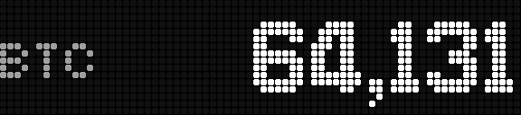

Point the app at any address that answers JSON or plain text, such as a Prometheus or InfluxDB query, a price, a sensor or a status page, and the front display shows the number in large digits under your label, yellow or red past your thresholds. OK shows a chart of the last readings, and the back display adds their minimum and maximum. Out of the box it shows the price of bitcoin from CoinGecko.

A JavaScript app for [BUSY Bar](https://busy.app).

## What the bar shows

The front display shows your label small on the left and the number in large digits on the right: whole with thousands separators from 1,000, with up to two decimals under it.

With a unit set, it goes under the label. The number turns yellow from the yellow threshold up and red from the red one up.

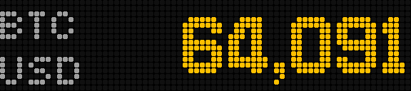

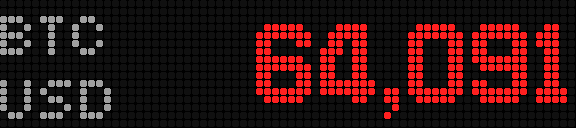

With the answer format set to plain text, the whole answer is the value: a number is shown like a number, any other text follows the label in a font with lowercase, cut to 100 characters. A text wider than the room left scrolls; one that fits stands still. Here the address is GitHub's zen API.

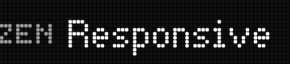

OK shows a chart of the last 72 numbers, one per request, the newest on the right, the lowest at the bottom and the highest at the top, in the color of the thresholds for the latest one. Over it are the label and the latest value with its unit. OK again shows the number.

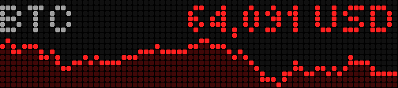

The back display shows the value large with the label and the unit beside it, and under it the minimum and the maximum of the chart's numbers and the time the value came on the bar's clock.

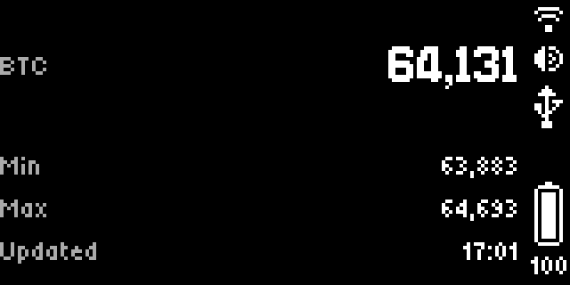

A plain-text answer is shown on the back display too, scrolling when it is long.

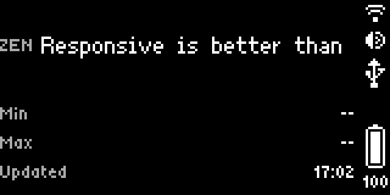

The last value and the chart's numbers are kept on the bar: at the start the ones kept for the same address, format and path are shown dimmed until the first answer, and `--` without them. When a request fails, the last value stays, dimmed, with a red cross under the label, before the unit; on the chart the cross comes before the label, and the back display is dimmed.

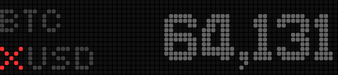

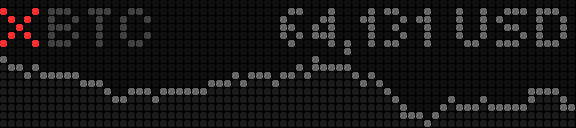

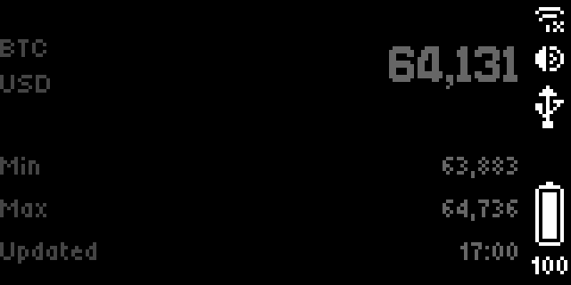

Without a connection and with nothing kept for the address, the value is `--`.

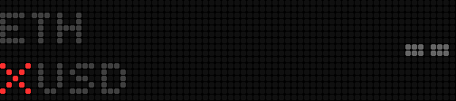

## Buttons

| Button | What it does |
| --- | --- |
| OK | Shows the chart of the last readings, and the number again. |
| Back | Leaves the app. |

## Settings

| Setting | What it does |
| --- | --- |
| Address | An http(s) address that answers JSON or plain text. Default: CoinGecko's price of bitcoin in US dollars. |
| Answer format | JSON, the default, or Plain text: the whole answer is shown, a number like a number, and the path is not used. |
| Path to the number | Where the number is in the JSON: keys with dots, list items in brackets, such as `data.result[0].value[1]` for a Prometheus query or `results[0].series[0].values[0][1]` for InfluxDB 1.x. A number sent as a string is read too. Default: `bitcoin.usd`. |
| Label | Up to 8 characters, shown small before the number. Default: BTC. |
| Unit | Up to 4 characters, shown small under the label. Empty by default. |
| Seconds between requests | 10 to 86400. Default: 60. |
| Yellow from | The number turns yellow at this value and above. 0, the default, turns it off. |
| Red from | The number turns red at this value and above. 0, the default, turns it off. |
| Authorization header | Sent as is when not empty, such as `Bearer <token>`. Empty by default. |

The app reads its settings when it starts.

## Data

Whatever endpoint you point it at: one request every interval from the settings, with your Authorization header if you set one. An answer without a number at the path counts as a failed request.

## Build

Node 24 and npm:

```sh
npm ci
npm run build         # dist/io.github.vvzvlad.jsonwidget.tgz
npm run app:install   # install it on a BUSY Bar connected over USB
npm run app:run       # start it
```

## License

[MIT](LICENSE)
